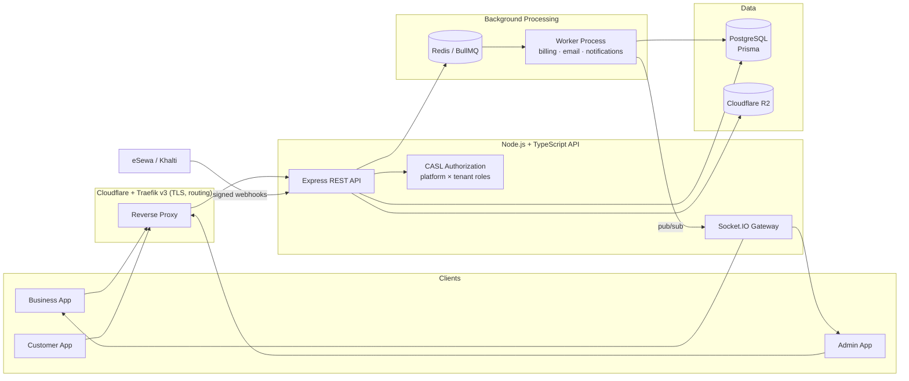

<!--
  SEO keywords: Prasiddha Khadka, Backend Developer Nepal, Node.js Developer, TypeScript Engineer,
  Multi-tenant SaaS Architect, PostgreSQL, Prisma, Redis, BullMQ, Docker, Software Engineer Pokhara
-->

<h1 align="center">Prasiddha Khadka — Backend Engineer & Multi-Tenant SaaS Developer</h1>

<p align="center">
  <a href="https://prasiddhakhadka.com.np">
    
  </a>
</p>

<p align="center">
  <a href="https://prasiddhakhadka.com.np"></a>
  <!-- TODO: replace YOUR-LINKEDIN-HANDLE with your real LinkedIn handle -->
  <a href="https://www.linkedin.com/in/YOUR-LINKEDIN-HANDLE"></a>
  <a href="https://github.com/PrasiddhaKhadka"></a>
  
</p>

<p align="center">
  <b>📍 Pokhara, Nepal</b> &nbsp;·&nbsp; <b>🟢 Open to backend / full-stack roles — Australia · Canada · Remote</b>
</p>

---

## 👋 About Me

I'm **Prasiddha Khadka**, a **backend software engineer from Nepal** who designs and ships **production multi-tenant SaaS platforms** end to end — from the database schema and authorization model to queues, payments, CI/CD and the VPS it runs on.

Currently **Lead Backend Developer at [Book Relax Glow](https://bookrelaxglow.com)**, where I architect and build the entire backend of a multi-vertical booking, POS and business-management platform for salons, spas, clinics, tattoo studios, fitness centres and pet-care businesses.

```ts
const prasiddha = {
  role:        "Lead Backend Developer",
  location:    "Pokhara, Nepal 🇳🇵",
  experience:  "5+ years — backend, full-stack, mobile, teaching",
  focus:       ["Multi-tenant SaaS", "Authorization", "Payments & billing", "Event-driven jobs"],
  coreStack:   ["Node.js", "TypeScript", "Express", "PostgreSQL", "Prisma", "Redis", "BullMQ", "Docker"],
  principles:  ["Tenant isolation at the DB layer", "Ledgers, not mutations", "Test before ship"],
  openTo:      ["Backend Engineer", "Full-Stack Engineer", "Platform Engineer"],
};
```

---

## 🛠️ Tech Stack

<p align="center">
  <br/>
  <br/>
  
</p>

| Layer | Technologies | How I use them |
|---|---|---|
| **Runtime & API** | Node.js, TypeScript, Express.js, REST, Joi, Swagger/OpenAPI | Layered architecture (repository → service → controller → validation), typed inputs, versioned APIs |
| **Data** | PostgreSQL, Prisma ORM, raw SQL where needed | Composite tenant-safe foreign keys, partial unique indexes, `EXCLUDE` constraints, hand-reviewed migrations |
| **Authorization** | CASL (RBAC + ABAC), JWT, OAuth 2.0 | Two-axis permission model (platform role × tenant role) with instance-level tenant checks |
| **Async & Real-time** | Redis, BullMQ, Socket.IO, Kafka | Job schedulers, separate worker processes, BullMQ → Redis pub/sub → WebSocket delivery |
| **Payments** | eSewa, Khalti, Fonepay (designed), webhooks | HMAC verification, idempotency keys, proration, subscription lifecycle |
| **Storage** | Cloudflare R2 (S3 API) | Presigned upload → direct PUT → HEAD-check confirm; keys stored, URLs signed on read |
| **Infra & DevOps** | Docker Compose, Traefik v3, Cloudflare, GitHub Actions, GHCR | Staging + production on one VPS, DNS-01 TLS, immutable image tags, PR-gated deploys |
| **i18n & Email** | i18next + AsyncLocalStorage, Nodemailer, EJS | Per-request locale (English / Nepali), templated transactional email |
| **Frontend & Mobile** | React, Next.js, Tailwind CSS, Flutter | MERN products, admin dashboards, cross-platform mobile apps |

---

## 🏗️ Featured Project — Book Relax Glow (Multi-Tenant SaaS)

> **[bookrelaxglow.com](https://bookrelaxglow.com)** · A booking, point-of-sale and business-management platform for service businesses in Nepal — I am the lead and sole backend engineer.



<details>
<summary><b>🔐 Multi-tenancy & authorization</b> — click to expand</summary>

- `Business` is the legal tenant root; `Branch` is always nested beneath it.
- **Composite tenant-safe foreign keys** — `(child_id, business_id) → parent(id, business_id)` — make cross-tenant references impossible at the database level, not just in application code.
- **Two-dimensional CASL model**: platform roles (super admin, operations, user) × tenant roles (owner, partner, manager, receptionist, staff), with branch-scoped conditions and instance-level checks.
- Staff **permission role** is deliberately separate from **job title**, so a dentist and a tattoo artist share identical permissions while showing different titles.
- JWT sessions carry a `token_version`; bumping it invalidates tokens and force-disconnects live sockets.
</details>

<details>
<summary><b>💳 Billing, payments & money handling</b></summary>

- All money stored as **`BigInt` minor units** (paisa) — no floating-point currency anywhere.
- Full subscription lifecycle: free tier on verification, upgrade / downgrade / cancel / add-ons, **millisecond-precision proration**, trial-farming prevention.
- eSewa integration with **HMAC signature verification** and webhook routing; idempotency keys on charge endpoints.
- Five scheduled billing jobs on BullMQ `upsertJobScheduler`, running in a dedicated worker process, with Bull Board monitoring.
</details>

<details>
<summary><b>🧾 POS, ledgers & profit distribution</b></summary>

- Checkout state machine (`open → awaiting_payment → paid`) with **split-tender payments** and a dynamic, admin-managed payment-method catalog.
- **Append-only ledgers** (`Revenue_Ledger`, `Staff_Commission_Ledger`, `Stock_Movement`) — refunds create offsetting entries, never deletions.
- Row locks and partial unique indexes close double-billing and concurrent-mutation races.
- Periodic **profit-period close**: staff costs (salary, commission, hybrid) and branch expenses are netted from revenue, then net profit is distributed to partners by basis-point shares.
- Salary proration verified with additive property tests (three 10-day closes ≡ one 30-day close, zero drift).
</details>

<details>
<summary><b>⚙️ Other modules I designed and built</b></summary>

| Module | Highlights |
|---|---|
| Business lifecycle | Six-state verification state machine with guarded, atomic transitions |
| Document & media uploads | Batch presigned R2 uploads, HEAD-check confirmation, signed reads |
| Google OAuth 2.0 | Authorization-code flow, account linking, cross-subdomain httpOnly cookies |
| Real-time notifications | Audience-keyed dispatch → BullMQ → Redis pub/sub → Socket.IO rooms |
| Inventory | Per-branch version-locked stock, movement ledger, purchase & restock approvals |
| Customers | Business-scoped customers, category-specific dynamic intake forms, visit notes |
| Loyalty | Stamp-card programs, combo matching, reward codes redeemed at POS |
| Support tickets | Threaded chat with FAQ bot suggestions and admin assignment |
| Calendar | Google Calendar links and `.ics` attachments in booking confirmations |
| Reporting | Timezone-aware (Asia/Kathmandu) revenue, booking and payment-method analytics |
</details>

<details>
<summary><b>🚀 DevOps & delivery</b></summary>

- **CI/CD**: GitHub Actions → GitHub Container Registry → SSH deploy.
- Flow: `feature → PR → staging` (auto-deploy & test) `→ PR → main` (production, pinned image tag).
- Separate Docker Compose projects for Traefik, staging and production on a shared network.
- Cloudflare-proxied DNS with **DNS-01 certificate challenges** to work around regional ISP routing issues.
- Scheduled `pg_dump` backups to object storage with retention.
- **4,000+ automated tests**, strict `tsc --noEmit` and ESLint gates before merge.
</details>

---

## 💼 Experience

| Period | Role | Company |
|---|---|---|
| **Jan 2026 – Present** | Lead Backend Developer | Book Relax Glow |
| May 2024 – Jan 2026 | MERN Stack Developer | Thanka Digital |
| Aug 2023 – May 2025 | Lead Mobile Application Developer | Firefly IT Solutions |
| 2022 – 2023 | Freelance Full-Stack & WordPress Developer | Self-employed |
| Aug 2021 – Apr 2022 | Mobile Application Developer | Nipuna Prabhidik Sewa |
| — | Assistant Lecturer — Web Development, Databases, Programming | Academia |

## 🎓 Education

**Bachelor of Software Engineering** — Gandaki College of Engineering & Science, Pokhara (2018 – 2023)

---

## 📊 GitHub Analytics

<p align="center">
  
  
</p>

<p align="center">
  
</p>

<p align="center">
  
</p>

<p align="center">
  <picture>
    <source media="(prefers-color-scheme: dark)" srcset="https://raw.githubusercontent.com/PrasiddhaKhadka/PrasiddhaKhadka/output/github-snake-dark.svg" />
    
  </picture>
</p>

---

## 🧭 Engineering Principles

1. **Enforce invariants in the database** — constraints beat comments.
2. **Never mutate history** — money and stock move through ledgers.
3. **Make every write atomic** — transactions, row locks and idempotency by default.
4. **Authorize the instance, not just the route** — tenant isolation is checked on the actual record.
5. **Ship small, reviewed layers** — repository → service → controller → validation, each tested.

---

## 🤝 Let's Connect

I'm open to **backend, full-stack and platform engineering roles** and to conversations about SaaS architecture, payments and multi-tenant systems.

<p align="center">
  <a href="https://prasiddhakhadka.com.np"><b>🌐 Portfolio</b></a> &nbsp;·&nbsp;
  <a href="https://www.linkedin.com/in/YOUR-LINKEDIN-HANDLE"><b>💼 LinkedIn</b></a> &nbsp;·&nbsp;
  <a href="https://github.com/PrasiddhaKhadka"><b>💻 GitHub</b></a>
</p>

<p align="center"><i>Prasiddha Khadka — Backend Engineer from Pokhara, Nepal, building scalable multi-tenant SaaS with Node.js, TypeScript and PostgreSQL.</i></p>
